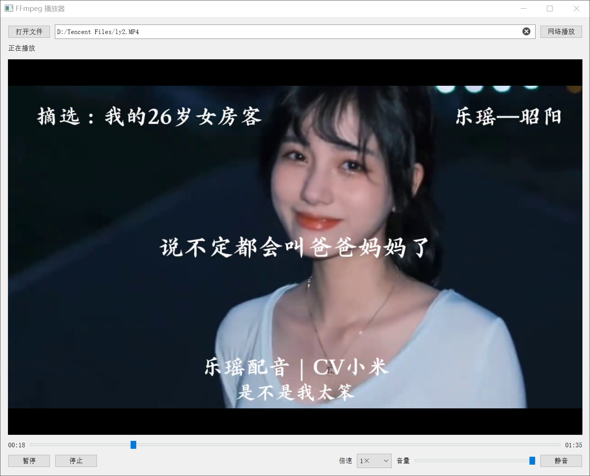

# ffmpegPlayer

基于 FFmpeg 和 Qt Widgets 的 Windows 音视频播放器，支持本地文件及网络媒体。

## 功能

- 打开本地音视频文件，支持中文和空格路径。
- 输入网络地址播放 HTTP/HTTPS 点播、RTSP 等网络媒体；具体协议和格式取决于随附的 FFmpeg。
- 播放、暂停、继续、停止，播放结束或停止后可再次播放当前媒体。
- 显示当前时间、总时长，对可定位的媒体支持进度拖动和快进、快退。
- 点播支持 0.5、1、1.5、2、3 倍速，使用 FFmpeg `atempo` 处理声音并保持音调。
- 音量 0～100、静音和恢复；切换媒体保留音量及点播倍速设置。
- 支持双击全屏、Esc 退出全屏，以及 Windows 高 DPI 显示缩放。

## 界面预览

## 使用

启动后点击“打开文件”选择媒体，或在地址框输入网络地址，点击播放按钮或按回车打开。

暂停后拖动进度仍保持暂停。未知时长或不可定位的媒体会禁用相应进度控制。实时直播使用 1 倍速；直播暂停会断开连接，恢复播放时重新连接到最新画面，不保留暂停期间的内容。倍速和定位操作可能出现短暂停顿。

| 快捷键 | 操作 |
| --- | --- |
| Ctrl+O | 打开本地文件 |
| 空格 | 播放 / 暂停 |
| ← / → | 快退 / 快进 15 秒 |
| ↑ / ↓ | 音量增加 / 减少 5 |
| M | 静音 / 恢复 |
| Esc | 退出全屏 |

编辑网络地址时，空格和方向键用于正常输入。

## 开发环境

- Visual Studio 2022，MSVC v143，Win32。
- Qt 5.12.11，MSVC2017 32 位版本；Qt VS Tools / Qt MSBuild。
- Qt 模块：Core、Gui、Widgets、Multimedia。
- FFmpeg 头文件和导入库位于 `ffmpegPlayer/include`、`ffmpegPlayer/lib`，运行 DLL 位于 `ffmpegPlayer/bin`。

打开仓库中的解决方案，在 Qt VS Tools 中将对应 Qt 版本注册为 `Qt5.12.11_msvc2017_32`。Debug 和 Release 均链接 FFmpeg 的 avcodec、avformat、avutil、avfilter、swscale、swresample。

工程已开启 Qt 自动部署，并在构建时复制 FFmpeg DLL 至程序输出目录。程序、Qt 和 FFmpeg DLL 必须保持一致的 32 位架构。

高 DPI 缩放跟随 Windows 显示设置；4K 显示器若设为 100% 缩放，控件仍会按 100% 显示。
